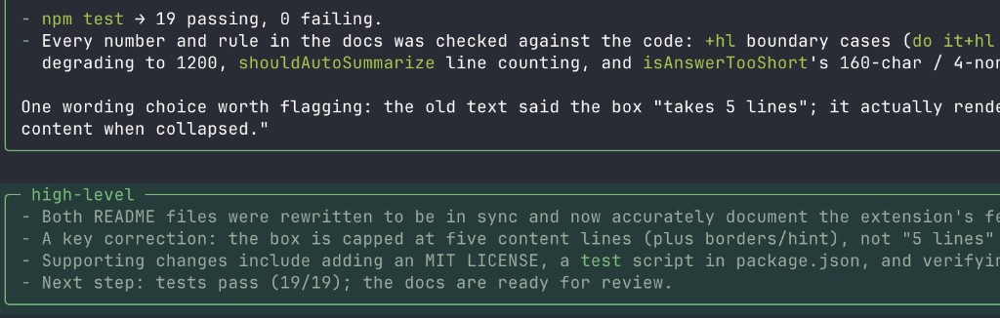

# pi-high-level

[中文](README.md) | English

Attaches a high-level summary to a Pi reply you pick. The box is a session entry rendered in the UI only; it never enters model context.



## Why use it

The conclusion of a long reply is usually buried under the steps that produced it. The box puts the conclusion, the trade-off, and the next step under the reply, capped at five lines of content when collapsed.

It is written to the session branch as a custom entry, so it is not part of model context and costs no tokens on later turns.

## Install

Requires a Pi build that provides `registerEntryRenderer` and `registerShortcut` (verified against 1.6.0), plus at least one authenticated model. The extension sends summary requests through `ctx.modelRegistry` and needs no extra key.

From GitHub:

```bash
pi install https://github.com/z472421519/pi-high-level
```

From a local directory, try it once, then save it to your personal config:

```bash
pi -e ./pi-high-level
pi install ./pi-high-level
```

An already open session loads a newly installed extension after `/reload`. If `/hl status` returns a line, the extension is running.

## Add a summary

Three ways to trigger it; use any one:

- `Ctrl+Shift+H`. While a reply is streaming, press it to arm a summary for that turn; the status line shows `hl: armed`, and pressing it again cancels. When Pi is idle, it summarizes the latest reply on the current branch.
- `+hl` at the end of a prompt. Only a trailing `+hl`, or `+hl` as the final line on its own, counts, and a space or line break must precede it: `do it+hl` does not match, and one in the middle does not either. The marker is removed before the prompt reaches the model. Queued `steer` and `followUp` messages work the same way. `+hl` alone, with no prompt, tells you to use `/hl` instead.
- `/hl`. Summarizes the latest reply; `/hl refresh` regenerates it; `/hl <prompt>` sends that prompt and summarizes the reply.

A reply that already has a box is not summarized twice.

## Commands

| Command | Effect |
| --- | --- |
| `/hl` | Summarize the latest reply. If a box exists, only notify; never overwrite |
| `/hl refresh` | Force a rewrite of the latest reply's box. Alias `/hl force` |
| `/hl <prompt>` | Send the prompt, then add a box under the reply. Queued as `followUp` while busy |
| `/hl model` | Show the current setting; opens a model picker when a UI is available |
| `/hl model <value>` | Set the summary model, see below. `reset` and `default` equal `current` |
| `/hl auto` | Same as toggling the switch |
| `/hl auto <value>` | Auto-summarize long replies, see below |
| `/hl timeout <value>` | Summary request timeout, default `18s`. Accepts `12s` or `5000ms`; values outside 3–120 seconds are silently clamped |
| `/hl prompt` | Show where the current summary prompt comes from |
| `/hl prompt file <path>` | Use a local text file |
| `/hl prompt reset` | Restore the built-in prompt. Aliases `builtin`, `default` |
| `/hl status` | One line with the model, auto threshold, timeout, and prompt source |

Values for `/hl model`:

- `auto`: prefers an authenticated model whose id contains `haiku`, `flash`, `mini`, `nano`, or `instant` on the active session model's provider, then across providers, and falls back to the session model.
- `current`: use the session model.
- `provider/id`: exact match, for example `anthropic/claude-haiku-4-5`.
- A bare model id: exact match on the active provider, then exact match anywhere, then a substring match.

Values for `/hl auto` (off by default):

- `on`, `off`, `toggle`, plus `true`, `false`, `0`.
- `<N>c` or `<N>chars`: summarize at N characters, minimum 160.
- `<N>l` or `<N>lines`: summarize at N lines, minimum 4.
- A bare number: 200 and above counts as characters, anything lower counts as lines.

When enabled, the default threshold is 1200 characters or 28 lines. Thresholds count all characters and all lines, blank ones included.

## Custom prompt

`/hl prompt file` points at a plain-text file. The path is stored as `promptFile` in the config file.

`{{question}}` and `{{answer}}` are replaced with this turn's question and answer. If the file contains neither placeholder, `<question>` and `<answer>` blocks are appended after the file text. The question is kept to 1200 characters, the answer to 16000 (the middle is dropped when over), and the prompt file to its first 8000 characters. If the file is missing, empty, or unreadable, that summary falls back to the built-in prompt and shows a notification.

The built-in prompt asks for 3 to 5 lines in the answer's language, covering the conclusion, the trade-off, and the concrete change or next step. It asks for no title, and no restatement of intermediate steps, code blocks, or long file lists.

## Configuration

The model, timeout, auto-summary thresholds, and `promptFile` live in `~/.pi/agent/pi-high-level.json`. Set `PI_CODING_AGENT_DIR` to use a different config directory.

```json
{
  "model": "auto",
  "timeoutMs": 18000,
  "auto": {
    "enabled": false,
    "minChars": 1200,
    "minLines": 28
  },
  "promptFile": "~/notes/hl-prompt.md"
}
```

Omitting `model` and `promptFile` means the session model and the built-in prompt. `promptFile` accepts a leading `~`. A hand-edited timeout is clamped to 3000–120000 milliseconds; `auto.minChars` below 200 and `auto.minLines` below 4 are ignored, so a character threshold such as `/hl auto 180c` falls back to 1200 on the next load.

Flags override the model and auto-summary for one launch without writing the file, and take precedence over the same keys in it:

```bash
pi --hl-model auto --hl-auto 1200c
```

`--hl-model` accepts `provider/id`, a model id, `auto`, or `current`. `--hl-auto` accepts `on`, `off`, `<N>c`, or `<N>l`.

## Behavior and limits

- A collapsed box shows at most 5 lines, with the overflow hint as the sixth (default `… +N lines (ctrl+o to expand)`; the key follows your Pi keybindings). `Ctrl+O` expands it and appends one metadata line: model, duration, source length, plus the trigger when it was not `+hl`.
- A reply under 160 characters and under 4 non-empty lines is skipped without calling the summary model. This check counts non-empty lines.
- A short post-tool confirmation is merged with the substantive answer earlier in the same turn instead of being summarized on its own.
- The summary request times out after 18 seconds by default and `Esc` cancels it. A timeout or failure only shows a notification; the original reply is untouched.
- The box is saved with the session and survives a restart.

## Development

```bash
npm test
```

Same as `node --test extensions/*.test.ts`. `extensions/core.test.ts` covers the pure functions; `extensions/wiring.test.ts` drives the event flow against stubbed extension APIs. The tests run `.ts` directly, so they need a Node with native TypeScript type stripping (verified on 26.7.0). Passing the directory (`node --test extensions/`) fails; pass the files.
