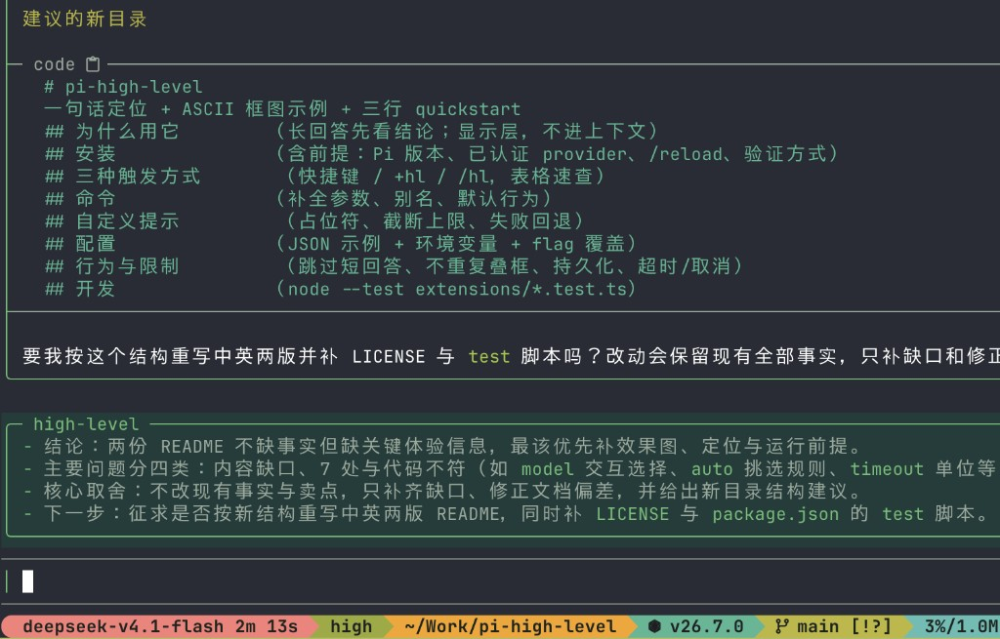

# pi-high-level

中文 | [English](README.en.md)

给指定的 Pi 回复挂一块高层总结。框图是会话里的自定义记录，只在界面显示，不进模型上下文。



## 为什么用它

长回复的结论常被中间过程埋住。框图把结论、取舍和下一步单独摊在回复下面，折叠时最多占 5 行内容。

它作为自定义记录写进会话分支，不参与模型上下文，后续每轮不会为它重复付 token。

## 安装

前提：Pi 提供 `registerEntryRenderer` 和 `registerShortcut` 这两个扩展 API（对照 1.6.0 验证），并且至少有一个已认证的模型。扩展借 `ctx.modelRegistry` 发总结请求，不需要额外配 key。

从 GitHub 安装：

```bash
pi install https://github.com/z472421519/pi-high-level
```

本地目录可以先试一次，再写入个人配置：

```bash
pi -e ./pi-high-level
pi install ./pi-high-level
```

已经打开的会话要执行 `/reload` 才会加载新装的扩展。装好后 `/hl status` 能返回一行状态，说明扩展已在运行。

## 生成一块总结

三种触发方式，任选一种：

- 快捷键 `Ctrl+Shift+H`。回复正在生成时按一下，给这一轮挂上总结，状态栏显示 `hl: armed`，再按一次取消。空闲时按同一个键，总结当前分支最近一条回复。
- 提示末尾的 `+hl`。只认文本最后的 `+hl`，或单独的最后一行 `+hl`；前面要有空格或换行，`do it+hl` 不生效，写在中间也不会触发。标记会在发给模型前去掉。排队中的 `steer` 和 `followUp` 消息同样生效。只写 `+hl` 而没带提示时会提示改用 `/hl`。
- 斜杠命令 `/hl`。给最近一条回复补框图；`/hl refresh` 强制重写；`/hl 你的提示` 先把这段提示发出去，再总结它的回复。

已经挂过框图的回复不会重复叠加。

## 命令

| 命令 | 作用 |
| --- | --- |
| `/hl` | 总结最近一条回复；已有框图时只提示，不重写 |
| `/hl refresh` | 强制重写最近一条回复的框图。别名 `/hl force` |
| `/hl <提示>` | 发送这段提示，并在回复后加框图。会话忙时按 `followUp` 排队 |
| `/hl model` | 查看当前设置；有交互界面时弹出模型选择列表 |
| `/hl model <值>` | 设置总结模型，见下文。`reset`、`default` 等同于 `current` |
| `/hl auto` | 不带参数等于切换开关 |
| `/hl auto <值>` | 长回复自动总结，见下文 |
| `/hl timeout <值>` | 总结请求超时，默认 `18s`。可写 `12s` 或 `5000ms`，超出 3–120 秒会被静默夹到边界 |
| `/hl prompt` | 查看当前总结提示的来源 |
| `/hl prompt file <路径>` | 改用一份本地文本文件 |
| `/hl prompt reset` | 恢复内置提示。别名 `builtin`、`default` |
| `/hl status` | 一行显示模型、自动阈值、超时、提示来源 |

`/hl model` 的取值：

- `auto`：先在当前会话模型所属 provider 里找 id 含 `haiku`、`flash`、`mini`、`nano`、`instant` 的已认证模型，再跨 provider 找，都没有就用当前会话模型。
- `current`：直接用当前会话模型。
- `provider/id`：精确指定，例如 `anthropic/claude-haiku-4-5`。
- 只写模型 id：先在当前 provider 里按 id 精确匹配，再全局精确匹配，最后按子串模糊匹配。

`/hl auto` 的取值（默认关闭）：

- `on`、`off`、`toggle`，也接受 `true`、`false`、`0`。
- `<N>c` 或 `<N>chars`：达到 N 个字符即总结，下限 160。
- `<N>l` 或 `<N>lines`：达到 N 行即总结，下限 4。
- 裸数字：大于等于 200 按字符算，否则按行算。

开启后默认阈值是 1200 字符或 28 行。阈值按字符总数或行总数算，空行也算。

## 自定义提示

`/hl prompt file` 指向一个纯文本文件，路径记在配置文件的 `promptFile` 里。

文件中的 `{{question}}` 和 `{{answer}}` 会换成本轮问题和回答。两个占位符都没写时，文件内容后面仍会附上 `<question>` 和 `<answer>` 块。问题最多保留 1200 字，回答最多 16000 字（超出时掐掉中间），提示文件最多使用开头 8000 字。文件缺失、为空或读不出来时，这一次回退到内置提示并弹通知。

内置提示要求用回答所用的语言写 3 到 5 行，只留结论、取舍，以及具体改动或下一步；不写标题，也不重复中间步骤、代码块和长文件列表。

## 配置

模型、超时、自动总结阈值和 `promptFile` 保存在 `~/.pi/agent/pi-high-level.json`。设置 `PI_CODING_AGENT_DIR` 可以换配置目录。

```json
{
  "model": "auto",
  "timeoutMs": 18000,
  "auto": {
    "enabled": false,
    "minChars": 1200,
    "minLines": 28
  },
  "promptFile": "~/notes/hl-prompt.md"
}
```

`model` 和 `promptFile` 省略表示用当前会话模型与内置提示。`promptFile` 支持开头的 `~`。手改超时会被夹在 3000–120000 毫秒之间；`auto.minChars` 低于 200、`auto.minLines` 低于 4 的值会被忽略，所以 `/hl auto 180c` 这类小于 200 的字符阈值在下次加载时会退回 1200。

单次启动可以用参数覆盖模型和自动总结，不写入这个文件，并且优先于文件里的同名设置：

```bash
pi --hl-model auto --hl-auto 1200c
```

`--hl-model` 接受 `provider/id`、模型 id、`auto` 或 `current`。`--hl-auto` 接受 `on`、`off`、`<N>c` 或 `<N>l`。

## 行为与限制

- 折叠时最多显示 5 行，第 6 行是折行提示（默认 `… +N lines (ctrl+o to expand)`，键位会跟着 Pi 的配置变）。按 `Ctrl+O` 展开后，末尾追加一行元信息：模型、耗时、原文长度；触发方式不是 `+hl` 时还会标出来源。
- 少于 160 个字符、并且少于 4 个非空行的回复直接跳过，不调用总结模型。这里数的是非空行。
- 一轮里工具调用后的简短收尾，会和同一轮前面那段实质回答拼在一起再总结，不会只总结一句话的确认。
- 总结请求默认 18 秒超时，可按 `Esc` 打断。超时或失败只弹通知，不改动原回复。
- 框图随会话保存，重开会话仍在。

## 开发

```bash
npm test
```

等价于 `node --test extensions/*.test.ts`。`extensions/core.test.ts` 覆盖纯函数，`extensions/wiring.test.ts` 用桩过的扩展 API 跑事件流程。测试直接跑 `.ts`，需要原生支持 TypeScript 类型擦除的 Node（已在 26.7.0 上验证）。传目录（`node --test extensions/`）会失败，需要传文件。
